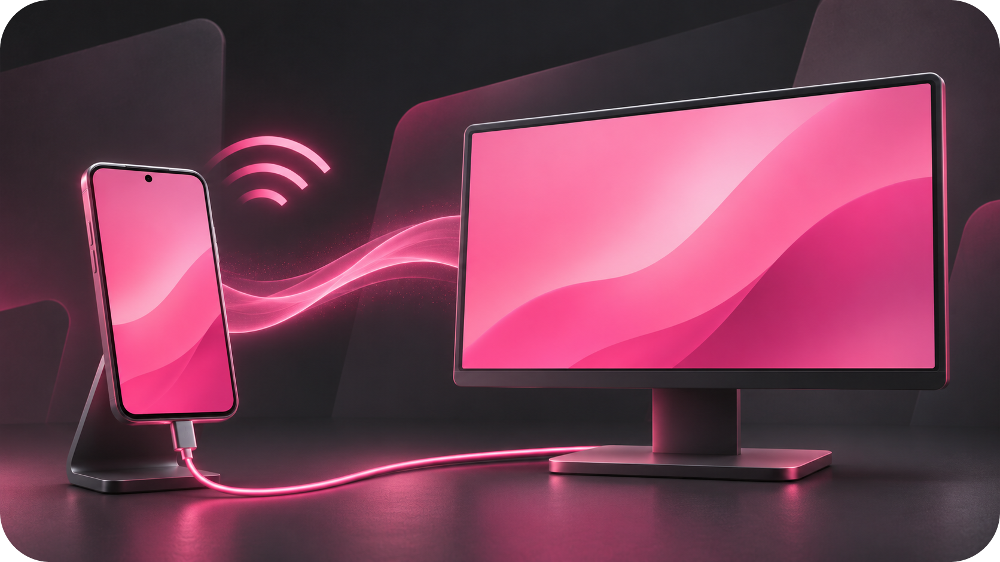
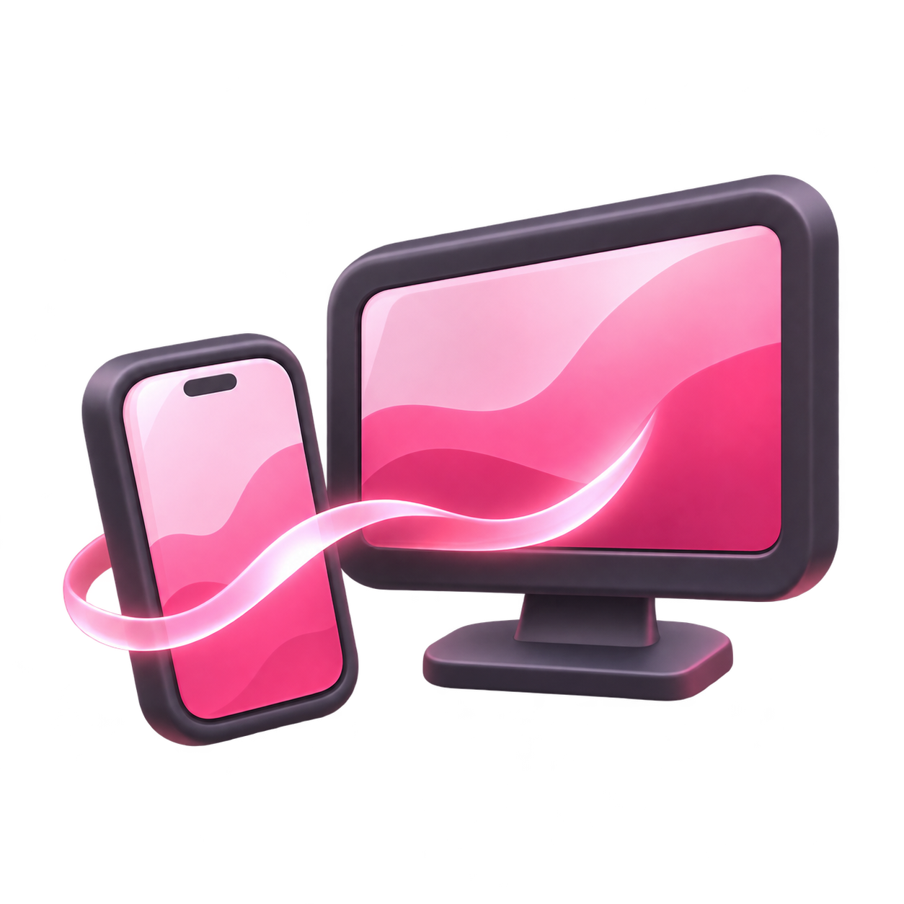
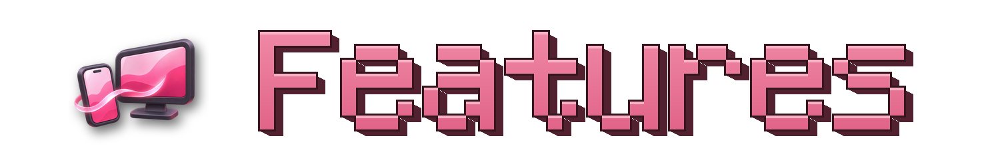
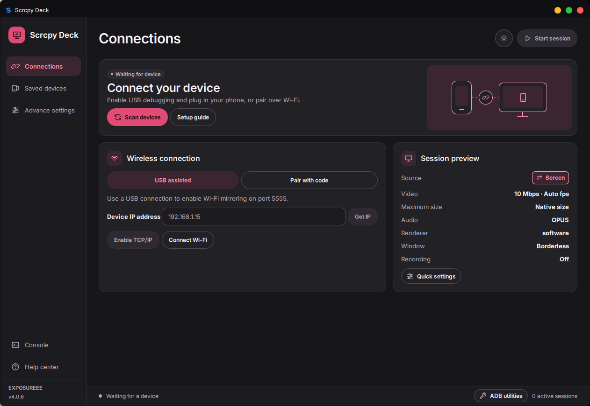

<h3> Scrcpy Deck</h3>

**Your Android, on your desktop.**

Connect a phone. Pick what to share. Start a scrcpy session from one Windows app.

Scrcpy Deck brings USB and Wi-Fi connections, screen mirroring, camera capture, microphone forwarding, and session controls into one place. ADB (Android Debug Bridge) talks to your phone; scrcpy opens the output in its own window.

[Get started](#run-on-windows) · [See the app](#see-the-app) · [Connect your phone](#connect-your-phone)

 

 

# Main Features

- **Connect your way** – *Use a USB cable, USB-assisted Wi-Fi, or an Android 11+ pairing code.*
- **Pick a source** – *Mirror the screen, show a camera, or forward the phone's microphone without video.*
- **Tune the session** – *Set video, audio, input, window, and recording options before you start.*
- **Save your devices** – *Keep nicknames and Wi-Fi addresses. Reconnect from the Saved devices page.*
- **Record and inspect** – *Save MP4 video and read live scrcpy and ADB output in the Console.*
- **Manage scrcpy** – *Download, switch, and keep local scrcpy engine versions in Help center.*
- **Choose your view** – *Use the light or dark app theme.*

## See the app

This is the current **Connections** screen in both themes. Select either image to open it at full size.

<table>
  <tr>
    <th align="center">Light</th>
    <th align="center">Dark</th>
  </tr>
  <tr>
    <td></td>
    <td></td>
  </tr>
</table>

## Run on Windows

You do not need Python to use a release. Use a **64-bit Windows** PC.

1. Open the [Scrcpy Deck releases page](https://github.com/EXPOSUREEE/Scrcpy-GUI-by-EXPOSUREEE/releases) and choose a release.
2. Download the Windows **installer** (`-setup.exe`). Run it and follow the steps on screen. If Windows asks whether to allow the installer to make changes, check that you opened the file from the project release, then select **Yes**.
3. Open **Scrcpy Deck** from the Start menu. You can also choose the **portable ZIP** on the release page, extract it, and run `ScrcpyDeck.exe` from the extracted folder.

The app uses scrcpy to show your phone. If it cannot find a scrcpy runtime, open **Help center → Updates** to download one. A developer who wants to run the code can follow [Run from source](#run-from-source).

## Connect your phone

### First, turn on developer options

The USB methods need **USB debugging**. The pairing code method uses **Wireless debugging** instead.

1. On your phone, open **Settings → About phone**. Find **Build number** or **Software version** and tap it seven times. Your phone may ask for its PIN. The path can differ by phone maker.
2. For the USB methods, go back to **Settings → Developer options** and turn on **USB debugging**.
3. If you cannot find these menus, open **Help center → USB debugging** in Deck and choose your phone maker.

### Method 1: Connect with a USB cable

1. Use a USB cable that can transfer **data**, not only charge. Connect the phone to the PC and unlock the phone.
2. When the phone asks **Allow USB debugging?**, allow this computer. You may need to choose a file transfer USB mode on some phones.
3. In Deck, open **Connections** and select **Scan devices**. Choose your phone if more than one device appears.
4. Select **Start session**. A scrcpy window opens with your phone's screen.

If the phone does not appear, reconnect the cable and check the phone for the permission prompt. Try another data cable or USB port. **Help center → USB debugging** has steps for different phone makers.

### Method 2: Start on USB, then use Wi-Fi

Use this when USB already works. Keep the phone and PC on the same network.

1. Connect the phone by USB and allow USB debugging as shown above.
2. On **Connections**, choose **USB assisted** under **Wireless connection**.
3. Select **Get IP**, then **Enable TCP/IP**, then **Connect Wi-Fi**.
4. When Deck shows **Connected over Wi-Fi**, unplug the cable. Select **Start session** to open the mirror.

You may need to repeat the USB setup after the phone restarts or its network address changes.

### Method 3: Pair with a code (Android 11+)

This method does not need a USB cable. Keep the phone and PC on the same Wi-Fi network.

1. On the phone, open **Developer options → Wireless debugging** and turn it on.
2. Select **Pair device with pairing code**. Keep this screen open. It shows an IP address, a **pairing port**, and a six-digit code.
3. In Deck, open **Connections → Pair with code**. Enter the **Device IP address**, **Pair port**, and **Pairing code**. Select **Pair**.
4. Return to the phone's main **Wireless debugging** screen. Enter its **connection port** in Deck, or select **Detect**. This port can be different from the pairing port.
5. Select **Connect**, then **Start session**.

After you have connected once, open **Saved devices** and select **Connect & start** to reconnect. You can give a device a nickname or change its Wi-Fi address there. If a saved Wi-Fi device stops connecting, attach it by USB and select **Recover over USB** when Deck offers it.

## Use the app

Connect a phone first. Open **Quick settings** from **Connections** or press **Ctrl+,**. Choose **Screen**, **Camera**, or **Mic**, then select **Apply & close**. Select **Start session** each time you want to open a new scrcpy session.

### Mirror your screen

Choose **Screen** in **Quick settings** and select **Start session**. Use the scrcpy window to view and control the phone. For more choices, open **Advance settings**. You can turn on **Read-only mirroring**, keep the phone awake, turn off its physical screen, or change the mirror window. Press **F5** to scan for devices again.

### Show your camera

Choose **Camera** in **Quick settings**. Select **Detect lenses** if you want a specific lens, or use **Camera facing** for the front or back camera. Select **Apply & close**, then **Start session**. You can also set the camera size, frame rate, rotation, and aspect ratio.

Camera capture needs **Android 12 or newer** and **scrcpy 2.0 or newer**. The camera and phone decide which sizes and frame rates work. Camera mode does not forward phone audio in Deck. See the [scrcpy camera guide](https://github.com/Genymobile/scrcpy/blob/master/doc/camera.md) for device limits.

### Hear only your phone's microphone

Choose **Mic** in **Quick settings**, select **Apply & close**, then **Start session**. Deck sends the phone's microphone audio without opening a video mirror. This needs **Android 11 or newer** and **scrcpy 2.0 or newer**. On Android 11, unlock the phone before starting. See the [scrcpy audio guide](https://github.com/Genymobile/scrcpy/blob/master/doc/audio.md) for more help.

### Improve picture quality

Open **Advance settings → Screen quality**. Raise **Video bitrate** for a clearer image. Set **Maximum size** to **Native size** for the phone's full size, and use **Frame rate limit** if you want to cap the frame rate. For camera capture, use **Camera bitrate** and **Maximum camera size** in the **Camera** section. Higher settings use more bandwidth and may run less smoothly over Wi-Fi.

### Save a session

Before starting, turn on **Record session to MP4** in **Advance settings → Recording & diagnostics**. For a camera session, you can use **Record camera stream to MP4** in **Quick settings**. Start the session, then close the scrcpy window when you are done. Deck saves a dated MP4 in your Windows `Videos\Scrcpy Deck` folder. In portable mode, it uses `portable_data\recordings`. Open **Console** to see the exact file path and any recording errors.

### Turn on the camera flash (torch)

Choose **Camera** and turn on **Enable camera torch** before you start. This uses the phone camera's light. It needs **scrcpy 4.0 or newer** and a camera that has a torch. Some phones or lenses may not allow it during capture. **Camera zoom** also needs scrcpy 4.0 or newer. If either control is unavailable, select **Update scrcpy** beside it.

### Use the other controls

- **Saved devices** – Reconnect, rename, or forget phones you have used.
- **Advance settings** – Set audio, video codec, input, window, and recording options.
- **Console** – Read errors and scrcpy or ADB output. You can copy or clear the log.
- **Screen connection → OTG** – Use keyboard and mouse control over USB without ADB authorization. This needs Windows USB driver access and does not show a mirror.

## Update the app and scrcpy

Open **Help center → Updates** and select **Check for updates**. This page has two parts:

1. **Scrcpy Deck updates** manages the app. Choose an application version, read its release notes if needed, and select the action shown. An installed release can download an installer, close Deck, install the chosen version, and restart. The portable edition opens the release page so you can download a new ZIP yourself.
2. **Scrcpy core engine updates** manages the scrcpy tool that runs the mirror. Choose a version and select the action shown to download it or switch to a version already on your PC. Deck shows a compatibility notice when an older version lacks a feature you use.

Both parts let you choose **Follow latest stable** or **Keep selected version**. If you are offline, Deck may show release details from its last check. An app started from source cannot install its own update in place; use Git to update that checkout.

## License

Scrcpy Deck is under **GPLv3**. See the [project license](LICENSE). The bundled runtime uses upstream scrcpy and ADB parts. See the [font and component notices](packaging/licenses) for their licenses.

## For developers

### Run from source

Use 64-bit Windows with Python 3.11 or later. Clone this repository. You also need a complete Windows x64 scrcpy runtime. Extract the [official scrcpy 5.0.1 release](https://github.com/Genymobile/scrcpy/releases/tag/v5.0.1) into `runtime/` beside `main.py`. Keep `scrcpy.exe`, `scrcpy-server`, and the DLL files together.

Open PowerShell in the project folder and run:

~~~powershell
python -m venv .venv
.\.venv\Scripts\python -m pip install -r requirements-dev.txt
.\.venv\Scripts\python main.py
~~~

Deck can also find a runtime beside the app or on `PATH`. You can download or switch versions from **Help center → Updates** after the app opens.

### Find the code you need

| Path | What it does |
| --- | --- |
| `main.py`, `assets.py` | Start the app and find files, tools, and the profile. |
| `qml/` | Draw the pages, settings, and themes. |
| `controller.py`, `workflows.py` | Keep app state and run device tasks in background threads. |
| `adb.py`, `library.py` | Talk to ADB and keep saved device details. |
| `scrcpy_command.py`, `processes.py` | Build scrcpy commands and run sessions. |
| `runtime_manager.py`, `updater.py` | Manage scrcpy versions and app updates. |
| `config.py`, `console.py` | Save settings and keep the latest 2,000 log lines. |

Keep device and process work in Python. QML draws the view. Only the GUI thread should change the app model.

Deck saves its profile at `%LOCALAPPDATA%\Scrcpy Deck\config.json`. Set `SCRCPY_DECK_PROFILE_DIR` for a separate test profile. A writable `portable.mode` marker beside the app uses `portable_data/`. Deck can import an older v4 profile on first run.

### Check your changes

Run these commands before you send a change:

~~~powershell
.\.venv\Scripts\python -m compileall .
.\.venv\Scripts\python -m pytest -q
~~~

For UI changes, open the app and check the screen by hand. For connection or capture changes, test without a phone and with an authorized phone when you can. Check USB, Wi-Fi, camera, microphone, and OTG paths that your change affects. Tests live in `tests/`.

### Build for Windows

Run `pyinstaller build/ScrcpyDeck.spec` to build the app at `dist/ScrcpyDeck/ScrcpyDeck.exe`. The spec has absolute paths, so set them to your checkout first. Use Inno Setup 6 with `Scrcpy_GUI_Installer.iss` to make an installer. Keep generated files out of your commit.

### Report an issue or contribute

For a bug or feature idea, open a [GitHub issue](https://github.com/EXPOSUREEE/Scrcpy-GUI-by-EXPOSUREEE/issues). Say what you tried, what happened, what you expected, and your Windows, Android, Deck, and scrcpy versions. Add the relevant **Console** output. Remove device IDs and other private details before posting it.

To contribute code, fork the repository, make a focused change, and run the checks above. Use a commit name such as `fix(adb): handle offline devices`. Open a [pull request](https://github.com/EXPOSUREEE/Scrcpy-GUI-by-EXPOSUREEE/pulls) with a short summary and your test steps. Add screenshots for UI changes. Do not commit `build/`, `dist/`, `*.spec`, `config.json`, executables, DLLs, or ADB keys.
