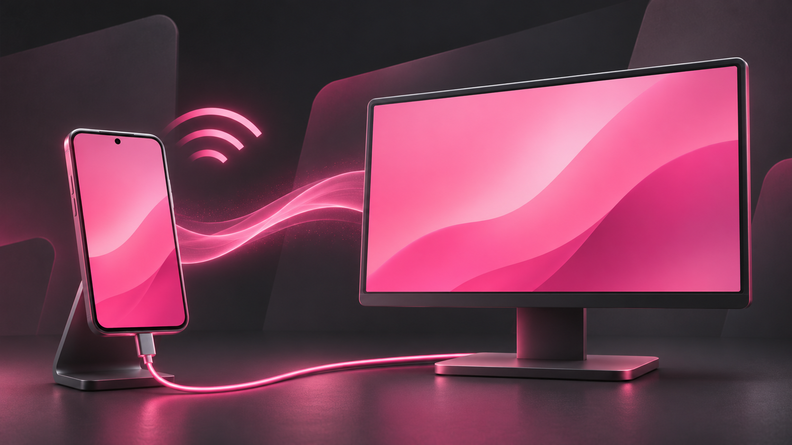
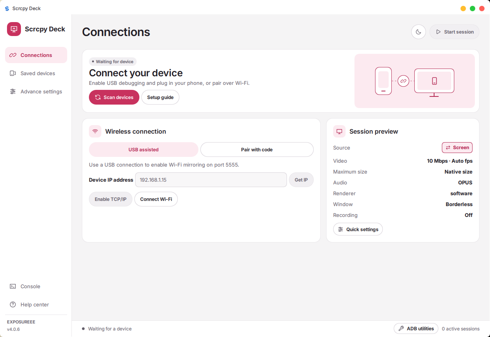

# Scrcpy Deck

### Your Android, on your desktop.

Connect a phone. Pick what to share. Start a scrcpy session from one Windows app.

Scrcpy Deck brings USB and Wi-Fi connections, screen mirroring, camera capture, microphone forwarding, and session controls into one place. ADB (Android Debug Bridge) talks to your phone; scrcpy opens the output in its own window.

[Get started](#run-on-windows) · [See the app](#see-the-app) · [Connect your phone](#connect-your-phone)

 

 

# Main Features

- **Connect your way** – *Use a USB cable, USB-assisted Wi-Fi, or an Android 11+ pairing code.*
- **Pick a source** – *Mirror the screen, show a camera, or forward the phone's microphone without video.*
- **Tune the session** – *Set video, audio, input, window, and recording options before you start.*
- **Save your devices** – *Keep nicknames and Wi-Fi addresses. Reconnect from the Saved devices page.*
- **Record and inspect** – *Save MP4 video and read live scrcpy and ADB output in the Console.*
- **Manage scrcpy** – *Download, switch, and keep local scrcpy engine versions in Help center.*
- **Choose your view** – *Use the light or dark app theme.*

## See the app

This is the current **Connections** screen in both themes. Select either image to open it at full size.

<table>
  <tr>
    <th align="center">Light</th>
    <th align="center">Dark</th>
  </tr>
  <tr>
    <td></td>
    <td></td>
  </tr>
</table>

## Run on Windows

### Install a release

Get the [v4.0.6 Windows installer](https://github.com/EXPOSUREEE/Scrcpy-GUI-by-EXPOSUREEE/releases/download/v4.0.6/ScrcpyDeck-4.0.6-windows-x64-setup.exe) or the [portable ZIP](https://github.com/EXPOSUREEE/Scrcpy-GUI-by-EXPOSUREEE/releases/download/v4.0.6/Scrcpy-GUI-v4.0.6-Portable-win64.zip) from the official release.

### Run from source

Use **64-bit Windows** and **Python 3.11 or later** to run the app from source.

1. Clone or download this repository.
2. In PowerShell, open the project folder and run:

~~~powershell
python -m venv .venv
.\.venv\Scripts\python -m pip install -r requirements.txt
.\.venv\Scripts\python main.py
~~~

3. Add a Windows x64 scrcpy runtime. Extract the complete [official scrcpy 5.0.1 Windows release](https://github.com/Genymobile/scrcpy/releases/tag/v5.0.1) into `runtime/` beside `main.py`. Keep `scrcpy-server` and the DLL files with `scrcpy.exe`. Deck also looks beside the app and on `PATH`.

You can also use the runtime manager in **Help center** to download and switch scrcpy versions after the app opens. Some capture options depend on the phone and scrcpy version.

## Connect your phone

| Method | What to do |
| --- | --- |
| **USB** | Turn on USB debugging on your phone. Connect a data cable and accept the phone's prompt. Select **Scan devices**, then **Start session**. If more than one connection appears, choose the right device card first. |
| **USB-assisted Wi-Fi** | Keep the cable attached. Put the phone and PC on the same network. Select **Get IP**, **Enable TCP/IP**, then **Connect Wi-Fi**. You can unplug the cable after Deck selects the Wi-Fi connection. |
| **Pair with code** | On Android 11+, open **Developer options → Wireless debugging → Pair device with pairing code**. In Deck, open **Pair with code** and enter the phone's IP, pairing port, and six-digit code. Then enter the connection port shown on the main Wireless debugging screen, or select **Detect**, and connect. |
| **Saved device** | Open **Saved devices** and select **Connect & start**. You can edit its nickname or Wi-Fi address, forget it, or use **Recover over USB** when its network address changes. |

If USB access fails, open **Help center** for setup steps. **Stop ADB server** can affect other apps that use ADB. **Reset connections** also removes your ADB keys; Deck asks you to confirm first.

## Set up a session

Open **Quick settings** with the gear button or **Ctrl+,**. Choose **Screen**, **Camera**, or **Mic**. Select **Apply & close** to use that source. Press **F5** to scan devices again.

- **Advance settings** has video and audio quality, codecs, renderer, screen orientation, window modes, device behavior, recording, and diagnostics.
- **Camera** lets you choose a lens, size, frame rate, rotation, aspect ratio, zoom, and torch. The phone and scrcpy version decide which choices work together.
- **Input** includes normal mirror control, UHID keyboard and mouse input, and USB OTG control without ADB authorization. OTG needs Windows USB driver access.
- **Recording** saves timestamped MP4 files in `Videos\Scrcpy Deck`. The Console shows the full file path. Close the scrcpy window to finish a recording.
- **Console** shows output, errors, exit codes, and help for common problems. You can copy or clear the log.

## Keep your setup

Deck saves its profile at `%LOCALAPPDATA%\Scrcpy Deck\config.json`. On first run, it can import an older v4 `config.json` beside the source or app. It keeps saved devices, nicknames, settings, and extra JSON fields. If a profile already exists in the user folder, Deck uses that one.

Set `SCRCPY_DECK_PROFILE_DIR` to use a separate profile. A writable `portable.mode` marker beside the app uses `portable_data/`. Deck saves changes shortly after you make them and again on normal exit.

The older CustomTkinter interface is available at commit `8e7de5a`. To open it in another checkout:

~~~powershell
git worktree add --detach ..\ScrcpyDeck-CustomTkinter 8e7de5a
~~~

## For developers

| Path | What it does |
| --- | --- |
| `main.py`, `assets.py` | Start Qt, find resources and tools, and choose the profile. |
| `qml/` | Draw the pages, settings, controls, and themes. |
| `controller.py`, `workflows.py` | Update app state and run device actions in the background. |
| `adb.py`, `library.py` | Talk to ADB and manage device records. |
| `scrcpy_command.py`, `processes.py` | Build scrcpy commands, start sessions, and report output. |
| `runtime_manager.py`, `updater.py` | Manage scrcpy versions and app updates. |
| `config.py`, `console.py` | Save settings and keep the recent log. |

The Console keeps the latest **2,000 lines**. The app loads QML pages as you open them and reuses device details until a connection changes.

<strong>Windows checks from this project</strong>

The Qt app was checked on Windows 11 with a Redmi 12 5G running Android 13. USB mirroring, camera, microphone, recording, wireless pairing, saved-device launch, and USB recovery completed. The USB OTG window opened and closed, but physical keyboard and mouse input were not part of that check.

Three source launches on the same machine gave a median time to a responsive window of **0.57 s** for Qt and **1.97 s** for the older CustomTkinter app. These are results from one machine, not a speed promise.

## License

Scrcpy Deck is under **GPLv3**. See the [project license](LICENSE). The bundled runtime uses upstream scrcpy and ADB parts. See the [font and component notices](packaging/licenses) for their licenses.
